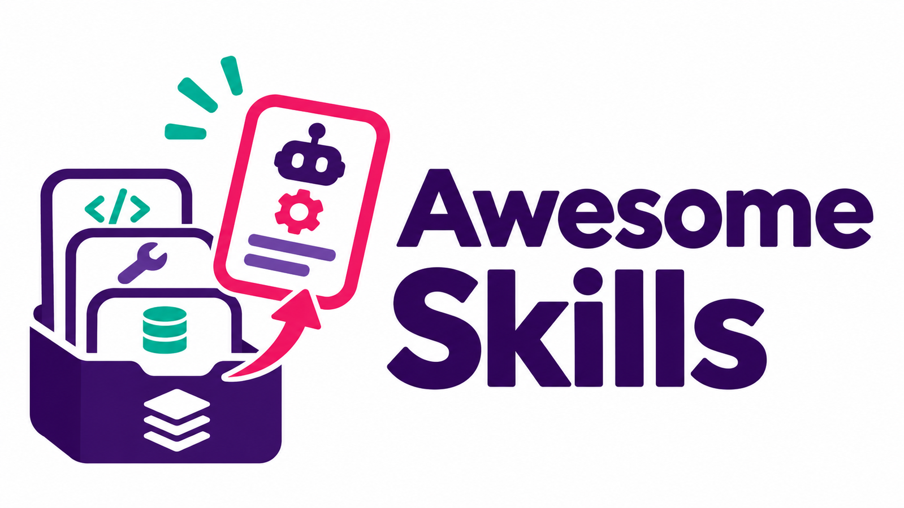

# Awesome Skills



<details>
<summary><strong>🌍 Languages · Sprachen · 18</strong></summary>

| | |
| --- | --- |
| [ English](../README.md) | [ Deutsch](README.de.md) |
| [ Español](README.es.md) | [ Français](README.fr.md) |
| [ Italiano](README.it.md) | [ Português](README.pt.md) |
| [ Nederlands](README.nl.md) | [ Polski](README.pl.md) |
| [ Türkçe](README.tr.md) | [ 日本語](README.ja.md) |
| [ 한국어](README.ko.md) | [ 中文](README.zh.md) |
| [ العربية](README.ar.md) | [ हिन्दी](README.hi.md) |
| [ Bahasa Indonesia](README.id.md) | [ Tiếng Việt](README.vi.md) |
| [ Українська](README.uk.md) | [ Svenska](README.sv.md) |

</details>

**41 Ressourcen** · [🌐 Awesome Awesome](https://github.com/Supersynergy/awesome-awesome-best-of-repo-lists) · [🧩💬 Partnerliste](https://github.com/Supersynergy/awesome-prompts) · [⭐ GitStars](https://gitstars.io/)

**🧭** [🏛️ Offizielle Quellen](#c-official) · [🧭 Sammlungen](#c-collections) · [🎯 Spezialisierte Skills](#c-specialized) · [🛡️ Sicherheit](#c-security) · [📺 Video-Anleitungen](#c-videos)

**🔗**

```text
https://github.com/Supersynergy/awesome-skills
```

**🧰** [JSONL](../data/sources.jsonl) · [URLs](../data/urls.txt)

<a id="c-official"></a>
<details open>
<summary><strong>🏛️ Offizielle Quellen · 7</strong></summary>

- **[Agent Skills specification](https://github.com/agentskills/agentskills)**<br>
  Offenes Format, Spezifikation und Referenzdokumentation.

- **[Anthropic Skills](https://github.com/anthropics/skills)**<br>
  Öffentliches Skill-Repository von Anthropic, darunter Dokumenten-Workflows.

- **[OpenAI Skills](https://github.com/openai/skills)**<br>
  Skill-Katalog für Codex; aktuelle Hinweise stehen in der Projekt-README.

- **[Vercel Agent Skills](https://github.com/vercel-labs/agent-skills)**<br>
  Offizielle Vercel-Sammlung für Agenten-Workflows.

- **[GitHub Awesome Copilot](https://github.com/github/awesome-copilot)**<br>
  Community-Anweisungen, Agenten, Prompts und Skills für Copilot.

- **[microsoft/skills](https://github.com/microsoft/skills)**<br>
  Skills, MCP-Server und Agentenanweisungen von Microsoft.

- **[anthropics/claude-plugins-official](https://github.com/anthropics/claude-plugins-official)**<br>
  Offizieller Anthropic-Plugin-Marktplatz für Claude Code.

</details>

<a id="c-collections"></a>
<details open>
<summary><strong>🧭 Sammlungen · 15</strong></summary>

- **[VoltAgent/awesome-agent-skills](https://github.com/VoltAgent/awesome-agent-skills)**<br>
  Verzeichnis offizieller und gemeinschaftlicher Skills für verschiedene Agenten.

- **[sickn33/agentic-awesome-skills](https://github.com/sickn33/agentic-awesome-skills)**<br>
  Umfangreiche Sammlung mit lokalem Katalog und Auswahlwerkzeugen.

- **[ComposioHQ/awesome-claude-skills](https://github.com/ComposioHQ/awesome-claude-skills)**<br>
  Claude-Skills und Ressourcen für Workflows.

- **[travisvn/awesome-claude-skills](https://github.com/travisvn/awesome-claude-skills)**<br>
  Kuratierte Sammlung für Claude und Claude Code.

- **[BehiSecc/awesome-claude-skills](https://github.com/BehiSecc/awesome-claude-skills)**<br>
  Sammlung von Claude-Skill-Ressourcen.

- **[heilcheng/awesome-agent-skills](https://github.com/heilcheng/awesome-agent-skills)**<br>
  Anleitungen, Tutorials und Skill-Verzeichnisse.

- **[libukai/awesome-agent-skills](https://github.com/libukai/awesome-agent-skills)**<br>
  Leitfaden, Ressourcen und Werkzeuge für Agent Skills.

- **[VoltAgent/awesome-openclaw-skills](https://github.com/VoltAgent/awesome-openclaw-skills)**<br>
  Skill-Verzeichnis für das OpenClaw-Ökosystem.

- **[composio-community/awesome-codex-skills](https://github.com/composio-community/awesome-codex-skills)**<br>
  Community-Sammlung für Codex-Skills.

- **[addyosmani/agent-skills](https://github.com/addyosmani/agent-skills)**<br>
  Entwicklungs-Skills für KI-Coding-Agenten.

- **[muratcankoylan/Agent-Skills-for-Context-Engineering](https://github.com/muratcankoylan/Agent-Skills-for-Context-Engineering)**<br>
  Skills für Context Engineering und Multi-Agenten-Systeme.

- **[vercel-labs/skills](https://github.com/vercel-labs/skills)**<br>
  Kommandozeilenwerkzeug für das offene Agent-Skills-Ökosystem.

- **[wshobson/agents](https://github.com/wshobson/agents)**<br>
  Plugins, Agenten und Skills für Coding-Werkzeuge.

- **[alirezarezvani/claude-skills](https://github.com/alirezarezvani/claude-skills)**<br>
  Sammlung von Skills, Agenten und Plugins.

- **[hashgraph-online/awesome-codex-plugins](https://github.com/hashgraph-online/awesome-codex-plugins)**<br>
  Verzeichnis von Codex-Plugins, Skills und Ressourcen.

</details>

<a id="c-specialized"></a>
<details open>
<summary><strong>🎯 Spezialisierte Skills · 12</strong></summary>

- **[gamedev-skills/awesome-gamedev-agent-skills](https://github.com/gamedev-skills/awesome-gamedev-agent-skills)**<br>
  Skills für Spieleentwicklung mit verschiedenen Engines.

- **[joe-shenouda/awesome-cyber-skills](https://github.com/joe-shenouda/awesome-cyber-skills)**<br>
  Skill-Ressourcen mit Schwerpunkt Cybersicherheit.

- **[bergside/awesome-design-skills](https://github.com/bergside/awesome-design-skills)**<br>
  Skills für Designaufgaben.

- **[K-Dense-AI/scientific-agent-skills](https://github.com/K-Dense-AI/scientific-agent-skills)**<br>
  Skills für wissenschaftliche Arbeitsabläufe.

- **[supabase/agent-skills](https://github.com/supabase/agent-skills)**<br>
  Skills für die Entwicklung mit Supabase.

- **[twostraws/Swift-Agent-Skills](https://github.com/twostraws/Swift-Agent-Skills)**<br>
  Skills für Swift und Apple-Plattformen.

- **[apify/agent-skills](https://github.com/apify/agent-skills)**<br>
  Agenten-Skills von Apify.

- **[WordPress/agent-skills](https://github.com/WordPress/agent-skills)**<br>
  Skills für WordPress-Entwicklung.

- **[callstackincubator/agent-skills](https://github.com/callstackincubator/agent-skills)**<br>
  Skills für React-Native-Entwicklung.

- **[Kotlin/kotlin-agent-skills](https://github.com/Kotlin/kotlin-agent-skills)**<br>
  Skills für Kotlin-Entwicklung.

- **[coreyhaines31/marketingskills](https://github.com/coreyhaines31/marketingskills)**<br>
  Agenten-Skills für Marketing-Workflows.

- **[Nutlope/hallmark](https://github.com/Nutlope/hallmark)**<br>
  Design-Skill für Coding-Agenten.

</details>

<a id="c-security"></a>
<details open>
<summary><strong>🛡️ Sicherheit · 4</strong></summary>

- **[LLMSecurity/awesome-agent-skills-security](https://github.com/LLMSecurity/awesome-agent-skills-security)**<br>
  Ressourcen zu Angriffen, Abwehr und Evaluation von Agent-Skills.

- **[thirtysix/awesome-agent-skills](https://github.com/thirtysix/awesome-agent-skills)**<br>
  Sicherheitsorientierter Skill-Katalog mit Offline-Scanergebnissen.

- **[trailofbits/skills](https://github.com/trailofbits/skills)**<br>
  Skills von Trail of Bits für Sicherheitsanalyse und Tests.

- **[NVIDIA/SkillSpector](https://github.com/NVIDIA/SkillSpector)**<br>
  Sicherheitsscanner für KI-Agenten-Skills.

</details>

<a id="c-videos"></a>
<details open>
<summary><strong>📺 Video-Anleitungen · 3</strong></summary>

> Ausgewählte Videos; keine gemessene Trend-Rangliste.

- **[25 agent skills to improve your workflow in GitHub Copilot](https://www.youtube.com/watch?v=9yPyoxlyc5Q)**<br>
  GitHub Copilot Day: Matt Pocock stellt Agenten-Skills vor.

- **[Introducing Agent Skills in VS Code](https://www.youtube.com/watch?v=JepVi1tBNEE)**<br>
  Einführung des Visual-Studio-Code-Teams in Agent Skills.

- **[The complete guide to Agent Skills](https://www.youtube.com/watch?v=fabAI1OKKww)**<br>
  Burke Holland erklärt Agent Skills.

</details>

---

<sub>GitHub-Repository-Daten am 12.11.2026 geprüft. Quellen können sich ändern; aktuellen Status und Lizenz bitte beim jeweiligen Projekt nachsehen.</sub>
