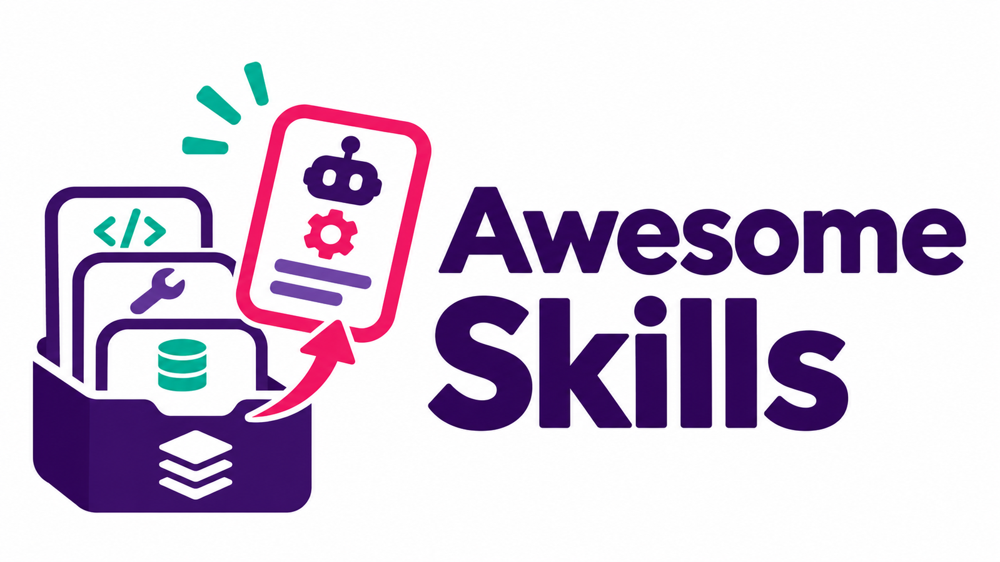

# Awesome Skills



<details>
<summary><strong>🌍 Languages · Sprachen · 18</strong></summary>

| | |
| --- | --- |
| [ English](../README.md) | [ Deutsch](README.de.md) |
| [ Español](README.es.md) | [ Français](README.fr.md) |
| [ Italiano](README.it.md) | [ Português](README.pt.md) |
| [ Nederlands](README.nl.md) | [ Polski](README.pl.md) |
| [ Türkçe](README.tr.md) | [ 日本語](README.ja.md) |
| [ 한국어](README.ko.md) | [ 中文](README.zh.md) |
| [ العربية](README.ar.md) | [ हिन्दी](README.hi.md) |
| [ Bahasa Indonesia](README.id.md) | [ Tiếng Việt](README.vi.md) |
| [ Українська](README.uk.md) | [ Svenska](README.sv.md) |

</details>

**41 sumber** · [🌐 Awesome Awesome](https://github.com/Supersynergy/awesome-awesome-best-of-repo-lists) · [🧩💬 Daftar terkait](https://github.com/Supersynergy/awesome-prompts) · [⭐ GitStars](https://gitstars.io/)

> Deskripsi sumber tersedia dalam bahasa Inggris.

**🧭** [🏛️ Sumber resmi](#c-official) · [🧭 Koleksi](#c-collections) · [🎯 Keahlian khusus](#c-specialized) · [🛡️ Keamanan](#c-security) · [📺 Video](#c-videos)

**🔗**

```text
https://github.com/Supersynergy/awesome-skills
```

**🧰** [JSONL](../data/sources.jsonl) · [URLs](../data/urls.txt)

<a id="c-official"></a>
<details open>
<summary><strong>🏛️ Sumber resmi · 7</strong></summary>

- **[Agent Skills specification](https://github.com/agentskills/agentskills)**<br>
  Open format, specification, and reference documentation.

- **[Anthropic Skills](https://github.com/anthropics/skills)**<br>
  Anthropic's public skills repository, including document workflows.

- **[OpenAI Skills](https://github.com/openai/skills)**<br>
  Catalog of skills for Codex; consult its current README for status and usage.

- **[Vercel Agent Skills](https://github.com/vercel-labs/agent-skills)**<br>
  Official Vercel collection for agent workflows.

- **[GitHub Awesome Copilot](https://github.com/github/awesome-copilot)**<br>
  Community instructions, agents, prompts, and skills for Copilot.

- **[microsoft/skills](https://github.com/microsoft/skills)**<br>
  Microsoft skills, MCP servers and agent instructions.

- **[anthropics/claude-plugins-official](https://github.com/anthropics/claude-plugins-official)**<br>
  Anthropic official plugin marketplace for Claude Code.

</details>

<a id="c-collections"></a>
<details open>
<summary><strong>🧭 Koleksi · 15</strong></summary>

- **[VoltAgent/awesome-agent-skills](https://github.com/VoltAgent/awesome-agent-skills)**<br>
  Directory of official and community skills across agent tools.

- **[sickn33/agentic-awesome-skills](https://github.com/sickn33/agentic-awesome-skills)**<br>
  Large collection with a local catalog and selection tools.

- **[ComposioHQ/awesome-claude-skills](https://github.com/ComposioHQ/awesome-claude-skills)**<br>
  Claude skills and workflow resources.

- **[travisvn/awesome-claude-skills](https://github.com/travisvn/awesome-claude-skills)**<br>
  Curated collection focused on Claude and Claude Code.

- **[BehiSecc/awesome-claude-skills](https://github.com/BehiSecc/awesome-claude-skills)**<br>
  Collection of Claude skill resources.

- **[heilcheng/awesome-agent-skills](https://github.com/heilcheng/awesome-agent-skills)**<br>
  Guides, tutorials, and skill directories.

- **[libukai/awesome-agent-skills](https://github.com/libukai/awesome-agent-skills)**<br>
  Agent Skills guide, resources, and tools.

- **[VoltAgent/awesome-openclaw-skills](https://github.com/VoltAgent/awesome-openclaw-skills)**<br>
  Skills directory for the OpenClaw ecosystem.

- **[composio-community/awesome-codex-skills](https://github.com/composio-community/awesome-codex-skills)**<br>
  Community collection focused on Codex skills.

- **[addyosmani/agent-skills](https://github.com/addyosmani/agent-skills)**<br>
  Engineering skills for AI coding agents.

- **[muratcankoylan/Agent-Skills-for-Context-Engineering](https://github.com/muratcankoylan/Agent-Skills-for-Context-Engineering)**<br>
  Agent skills for context engineering and multi-agent systems.

- **[vercel-labs/skills](https://github.com/vercel-labs/skills)**<br>
  Command-line tool for the open agent skills ecosystem.

- **[wshobson/agents](https://github.com/wshobson/agents)**<br>
  Plugins, agents and skills for coding tools.

- **[alirezarezvani/claude-skills](https://github.com/alirezarezvani/claude-skills)**<br>
  Collection of skills, agents and plugins.

- **[hashgraph-online/awesome-codex-plugins](https://github.com/hashgraph-online/awesome-codex-plugins)**<br>
  Directory of Codex plugins, skills and resources.

</details>

<a id="c-specialized"></a>
<details open>
<summary><strong>🎯 Keahlian khusus · 12</strong></summary>

- **[gamedev-skills/awesome-gamedev-agent-skills](https://github.com/gamedev-skills/awesome-gamedev-agent-skills)**<br>
  Game development skills across multiple engines.

- **[joe-shenouda/awesome-cyber-skills](https://github.com/joe-shenouda/awesome-cyber-skills)**<br>
  Security-focused skill resources.

- **[bergside/awesome-design-skills](https://github.com/bergside/awesome-design-skills)**<br>
  Design-related skills.

- **[K-Dense-AI/scientific-agent-skills](https://github.com/K-Dense-AI/scientific-agent-skills)**<br>
  Skills for scientific research workflows.

- **[supabase/agent-skills](https://github.com/supabase/agent-skills)**<br>
  Skills for Supabase development.

- **[twostraws/Swift-Agent-Skills](https://github.com/twostraws/Swift-Agent-Skills)**<br>
  Skills for Swift and Apple platform development.

- **[apify/agent-skills](https://github.com/apify/agent-skills)**<br>
  Apify agent skills.

- **[WordPress/agent-skills](https://github.com/WordPress/agent-skills)**<br>
  WordPress development skills.

- **[callstackincubator/agent-skills](https://github.com/callstackincubator/agent-skills)**<br>
  React Native development skills.

- **[Kotlin/kotlin-agent-skills](https://github.com/Kotlin/kotlin-agent-skills)**<br>
  Kotlin development skills.

- **[coreyhaines31/marketingskills](https://github.com/coreyhaines31/marketingskills)**<br>
  Agent skills for marketing workflows.

- **[Nutlope/hallmark](https://github.com/Nutlope/hallmark)**<br>
  Design skill for coding agents.

</details>

<a id="c-security"></a>
<details open>
<summary><strong>🛡️ Keamanan · 4</strong></summary>

- **[LLMSecurity/awesome-agent-skills-security](https://github.com/LLMSecurity/awesome-agent-skills-security)**<br>
  Resources on attacks, defenses, and evaluation of agent skills.

- **[thirtysix/awesome-agent-skills](https://github.com/thirtysix/awesome-agent-skills)**<br>
  Security-focused skill catalog and offline scan results.

- **[trailofbits/skills](https://github.com/trailofbits/skills)**<br>
  Trail of Bits skills for security analysis and testing.

- **[NVIDIA/SkillSpector](https://github.com/NVIDIA/SkillSpector)**<br>
  Security scanner for AI agent skills.

</details>

<a id="c-videos"></a>
<details open>
<summary><strong>📺 Video · 3</strong></summary>

> Video pilihan, bukan peringkat tren terukur.

- **[25 agent skills to improve your workflow in GitHub Copilot](https://www.youtube.com/watch?v=9yPyoxlyc5Q)**<br>
  Matt Pocock presents agent skills at GitHub Copilot Day.

- **[Introducing Agent Skills in VS Code](https://www.youtube.com/watch?v=JepVi1tBNEE)**<br>
  Visual Studio Code introduction to agent skills.

- **[The complete guide to Agent Skills](https://www.youtube.com/watch?v=fabAI1OKKww)**<br>
  Burke Holland explains agent skills.

</details>

---

<sub>Metadata GitHub diperiksa pada 12-11-2026. Lihat status dan lisensi terbaru di setiap proyek.</sub>
